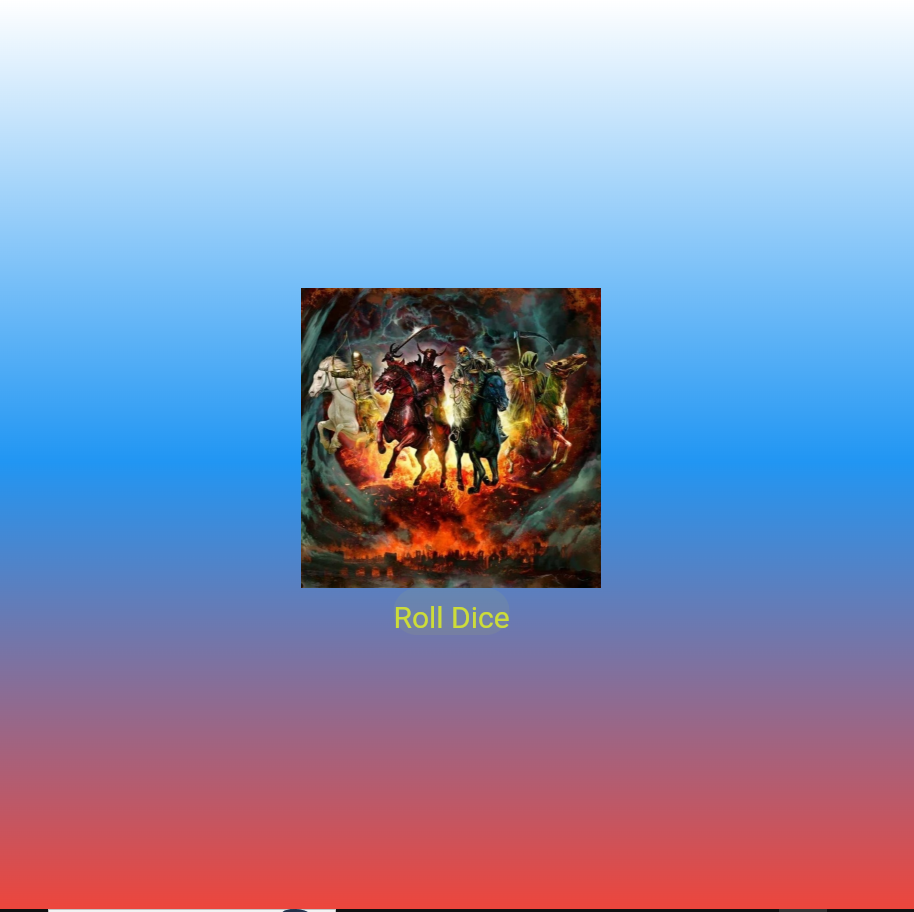

# Лабораторная работа №4-5. Flutter: структура UI и компонентный подход

## Обо мне

- **ФИО**: Саликов Аскар
- **Группа**: ИСП-241
- **Дата**: 12.10.2026

## Что изучили

- Работа со Stateless и Statefull виджетами
- Разбивать код на компоненты
- Работа с изображениями
- Генерация случайных чисел

## Скриншот финального приложения

_Финальная версия приложения Roll Dice:_



## Ссылка на репозиторий

[Flutter_Widgets](https://github.com/xekk829/Flutter_Widgets)

## Инструкция по запуску

Для запуска проекта выполните следующие шаги в терминале:

1. Клонируйте репозиторий:

```bash
git clone https://github.com/xekk829/Flutter_Widgets.git
```

2. Перейдите в папку проекта:

```bash
cd Flutter_Widgets
```

3. Установите зависимости:

```bash
flutter pub get
```

4. Запустите приложение (например, в браузере Chrome):

```bash
flutter run -d chrome
```

## Ответы на вопросы

1. > Зачем выносить виджеты в отдельные файлы? Что изменится если держать всё в main.dart?

Виджеты выносятся в отдельные файлы, чтоб не забивать `main.dart`. Если всё держать в одном файле, он очень сильно разрастётся и в нём будет трудно ориентироваться.

2. > Что такое BuildContext? Почему метод build() принимает его как параметр?

`BuildContext` — это объект, который содержит информацию о положении виджета в дереве. Метод `build()` использует его для того, чтоб движок Flutter знал точное расположение виджета, чтобы правильно отрисовывать его на экране.

3. > Чем StatelessWidget отличается от StatefulWidget? Приведите пример когда нужен каждый из них.

`StatelessWidget` - виджет без состояния. Он не изменяется в ходе работы приложения. Используется в статитичных текстах, фонах, изображениях. `StatefulWidget` используется, когда виджет необходимо изменять, например, используется для игральной кости, которая изменяется по клику по кнопке.

4. > Почему Random() создаётся на уровне файла, а не внутри rollDice()?

Если создавать `Random()` внутри `rollDice()`, то при каждом нажатии на кнопку будет создаваться новый объект `Random()`.
